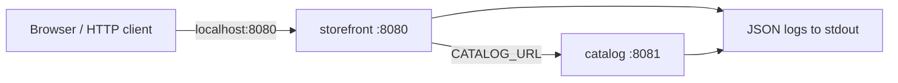

# 1. Setup and architecture

Allow 50–65 minutes for both tracks. You need basic terminal skills; no Kubernetes experience is assumed. Run all commands from the repository root.

## Prerequisites

| Track | Tools and resources |
| --- | --- |
| Docker | Docker Engine or Docker Desktop using Linux containers; Docker Compose v2 with `--wait`; a browser; free host port 8080 |
| Kubernetes | Docker prerequisites plus `kubectl` and [kind](https://kind.sigs.k8s.io/docs/user/quick-start/#installation); a local single-node cluster |
| Capacity | Allocate approximately 2 CPUs, 4 GiB memory, and 3 GiB free disk for this small lab |
| Network | First run downloads the Node base image and, for Kubernetes, a kind node image |
| Optional development | Node.js 22+ and npm; these are unnecessary for the learner commands inside containers |

Check the runtime:

```sh
docker version
docker compose version
```

Expected: both a Docker **Client** and **Server** section, and a Compose **v2** version. If only the client works, start Docker Desktop and wait for its engine. Use Linux containers. On Windows, `docker desktop start` is available in supported Docker Desktop versions; opening Docker Desktop also works.

For Kubernetes:

```sh
kubectl version --client
kind version
```

The validated lab used kind `v0.27.0`, Kubernetes `v1.32.2`, and kubectl `v1.32.2`. The Kubernetes guide pins the node image for repeatability. Keep your kubectl version compatible with the server you choose.

Commands are single-line and work in Bash and PowerShell. The optional `curl.exe` examples target Windows; on Linux/macOS, use `curl`. Windows PowerShell's `curl` alias behaves differently, which is why the guide uses `curl.exe`. The included `node app/probe.mjs` commands inside containers avoid that difference entirely.

## Application model



Both services use the same image, selected by `APP_ROLE`. The storefront proxies `/api/catalog` to the catalog's `/items`. Docker DNS and Kubernetes Service DNS both resolve the service name `catalog`. `localhost` inside a container means that container itself; it does not refer to the other service.

| Endpoint | Healthy | During the bad-port incident | Meaning |
| --- | --- | --- | --- |
| Storefront `/` | 200 HTML | 200 HTML | The page shell can be served |
| Storefront `/livez` | 200 | 200 | The HTTP process is alive |
| Storefront `/readyz` | 200 | 503 | Its catalog dependency is reachable and valid |
| Storefront `/api/catalog` | 200, three products | 503 `catalog_unavailable` | The customer workflow works or fails |
| Catalog `/items` | 200 | 200 | The catalog itself remains available |

The request timeout is 1.2 seconds. Requests log JSON containing the timestamp, service, event, status, and request ID. Dependency failures also log `upstream` and `errorCode`. Request IDs propagate to the catalog. Normal probe requests are quiet; failed dependency checks still emit error logs.

## Configuration tour

Inspect [the Dockerfile](../Dockerfile), [Compose configuration](../compose.yaml), and [storefront Deployment](../k8s/03-storefront.yaml).

- The image runs as the unprivileged `node` user. Both runtimes use a read-only filesystem.
- Compose checks `/readyz` with the Node-based health check; no `curl` package is installed in the image.
- Kubernetes uses `/readyz` for readiness and `/livez` for liveness. A dependency outage makes the Pod unready without repeatedly restarting its container.
- Kubernetes uses a single replica and `Recreate` for the storefront. This intentionally creates downtime and makes the exercise deterministic; it is a lab strategy.
- `imagePullPolicy: Never` requires loading the built image into kind. No registry is required.

Next: [Docker lab](02-docker-lab.md).

References: [Compose services and health checks](https://docs.docker.com/reference/compose-file/services/), [Kubernetes readiness and liveness probes](https://kubernetes.io/docs/tasks/configure-pod-container/configure-liveness-readiness-startup-probes/).
