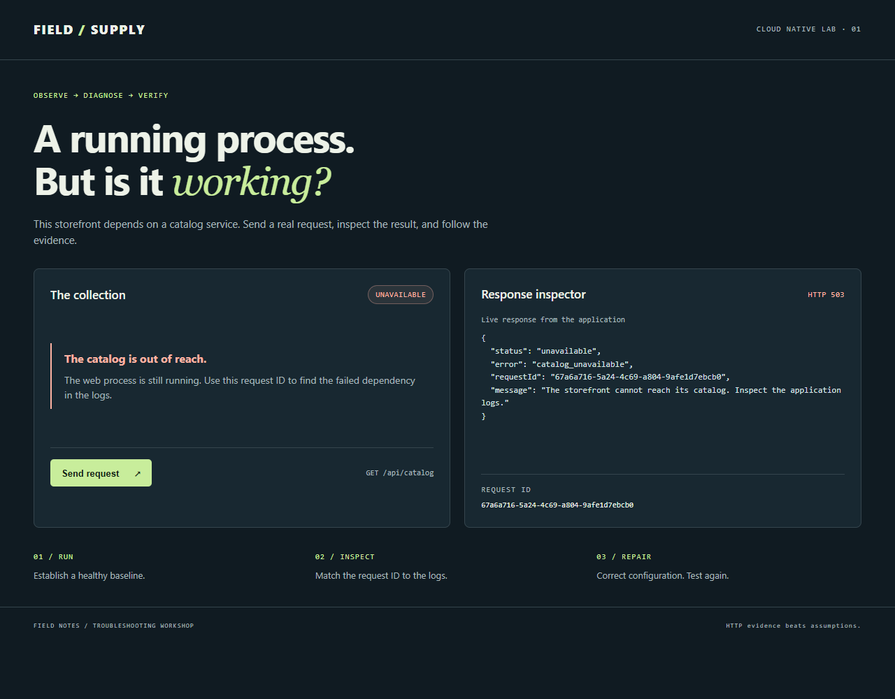
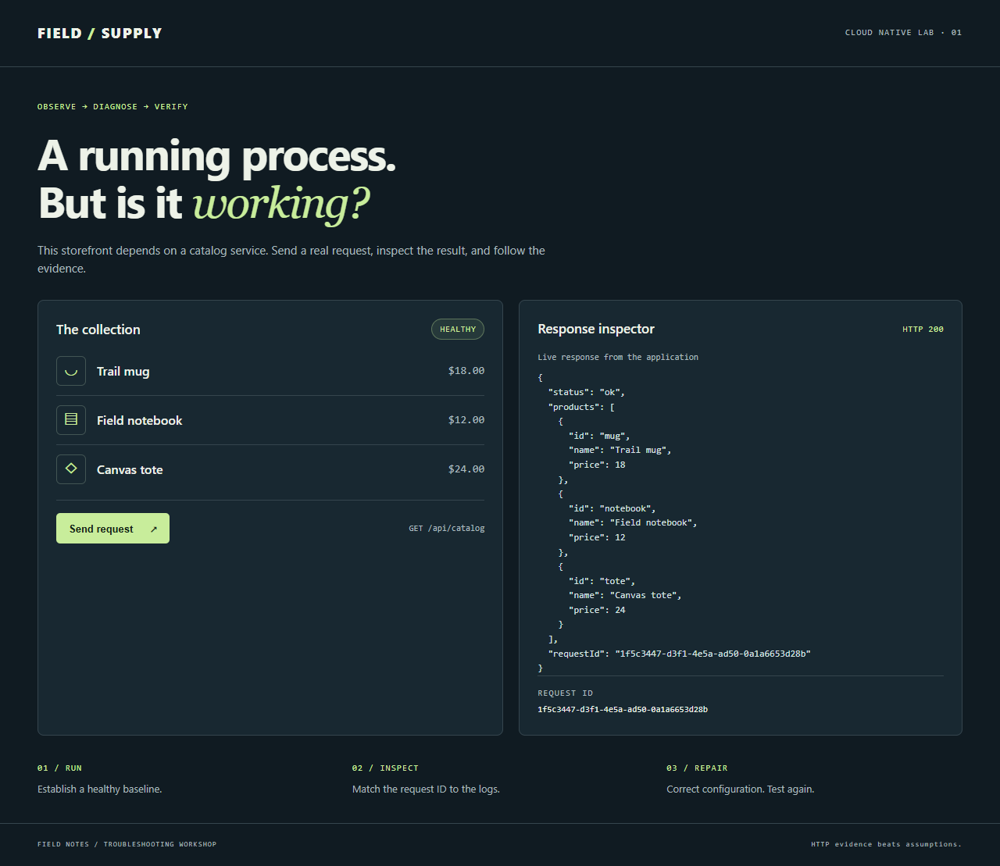

# 2. Docker: run, inspect, diagnose, verify

**Time:** about 20 minutes. **Goal:** establish a baseline, introduce one configuration error, prove its cause, and verify the repair. Keep the original YAML files as your known-good configuration.

## Step 1 — Build and run a healthy application

```sh
docker compose up -d --build --wait --wait-timeout 120
docker compose ps
docker compose exec storefront node app/probe.mjs http://127.0.0.1:8080/api/catalog 200 lab-baseline
```

Expected output, abbreviated; names, timings, and IDs vary:

```text
NAME                               SERVICE      STATUS
troubleshooting-lab-catalog-1      catalog      Up ... (healthy)
troubleshooting-lab-storefront-1   storefront   Up ... (healthy)
HTTP 200
{
  "status": "ok",
  "products": [ ... three products ... ],
  "requestId": "lab-baseline"
}
```

Open http://localhost:8080. The page should show **HEALTHY**, **HTTP 200**, and three products. Click **Send request** to create another request. Note the request ID in the response inspector.


The container-internal probe does not test the published host port. To check that path too, use the browser or, on Windows:

```sh
curl.exe -i http://localhost:8080/api/catalog
```

Expected: `HTTP/1.1 200 OK` and a `products` array.

## Step 2 — Inspect logs before the incident

```sh
docker compose logs --tail=20 storefront catalog
```

Find `lab-baseline` in both services. It ties the customer request to the upstream request. A typical storefront entry is:

```json
{"timestamp":"<time>","level":"info","service":"storefront","event":"http_request","requestId":"lab-baseline","method":"GET","path":"/api/catalog","status":200,"durationMs":8}
```

To follow new logs, use `docker compose logs -f storefront catalog` in another terminal. Press Ctrl+C to stop following; the containers keep running.

## Step 3 — Inject the problem

A deployment accidentally changed the catalog port. Apply the supplied Compose override:

```sh
docker compose -f compose.yaml -f scenarios/compose.bad-port.yaml up -d --no-deps --force-recreate storefront
docker compose exec storefront node app/probe.mjs http://127.0.0.1:8080/api/catalog 503 lab-broken
```

Expected:

```text
HTTP 503
{
  "status": "unavailable",
  "error": "catalog_unavailable",
  "requestId": "lab-broken",
  "message": "The storefront cannot reach its catalog. Inspect the application logs."
}
```

The probe exits successfully here because **503 is the expected status**. It fails if the actual status differs. Immediately after recreation, allow a second for the HTTP listener to start if the probe connects too early, then repeat it.

Refresh the browser. The page loads, but the catalog is **UNAVAILABLE** and the response is **HTTP 503**.



## Step 4 — Gather evidence, then state a hypothesis

```sh
docker compose ps
docker compose logs --since=2m --tail=30 storefront
docker compose exec storefront printenv CATALOG_URL
docker inspect troubleshooting-lab-storefront-1 --format '{{json .State.Health}}'
```

After approximately 15–25 seconds, `ps` reports the storefront as **unhealthy**, while catalog remains **healthy**. Before that, storefront may show `health: starting`. Inspect records eventually include `readiness HTTP 503` and a nonzero exit code.

The request's error log contains the decisive evidence:

```json
{"timestamp":"<time>","level":"error","service":"storefront","event":"dependency_failed","requestId":"lab-broken","upstream":"http://catalog:9090","errorCode":"ECONNREFUSED","durationMs":3}
```

The environment command prints:

```text
http://catalog:9090
```

Write a hypothesis before fixing anything: **the catalog name resolves, but nothing is listening on configured port 9090**. `ECONNREFUSED` is different from a DNS lookup failure such as `ENOTFOUND`.

Test from the storefront's own network namespace:

```sh
docker compose exec storefront node app/probe.mjs http://catalog:8081/items 200
docker compose exec storefront node app/probe.mjs http://127.0.0.1:8080/livez 200
docker compose exec storefront node app/probe.mjs http://127.0.0.1:8080/readyz 503
```

Expected: catalog returns three products; liveness returns `alive`; readiness returns `catalog_unavailable`. The dependency works at **8081**, and the web process is alive. Compare that with `compose.yaml`, which declares `CATALOG_URL: http://catalog:8081`.

**Checkpoint:** explain why restarting the same bad configuration would reproduce the incident.

## Step 5 — Repair the configuration

Recreate the storefront using only the known-good base file:

```sh
docker compose -f compose.yaml up -d --no-deps --force-recreate --wait --wait-timeout 60 storefront
docker compose exec storefront printenv CATALOG_URL
```

Expected: a healthy storefront and `http://catalog:8081`. A plain `docker compose restart` keeps the existing container's environment, so use recreation when changing environment configuration.

## Step 6 — Verify the fix at three levels

```sh
docker compose ps
docker compose exec storefront node app/probe.mjs http://127.0.0.1:8080/readyz 200
docker compose exec storefront node app/probe.mjs http://127.0.0.1:8080/api/catalog 200 lab-fixed-1
docker compose exec storefront node app/probe.mjs http://127.0.0.1:8080/api/catalog 200 lab-fixed-2
docker compose exec storefront node app/probe.mjs http://127.0.0.1:8080/api/catalog 200 lab-fixed-3
docker compose logs --since=1m --tail=20 storefront catalog
```

Success criteria:

- Both containers are healthy, and `/readyz` returns HTTP 200.
- All three requests return HTTP 200 and three products.
- Fresh storefront logs show `http_request` status 200 for `lab-fixed-1` through `lab-fixed-3`; the catalog logs carry the same IDs. Those requests have no `dependency_failed` entries.
- Refreshing the browser shows **HEALTHY**, **HTTP 200**, and all products through the published host port.

Old failures in a broad log window describe the earlier incident. Correlate the new request IDs rather than treating historical errors as a failed repair.



## Step 7 — Clean up or continue

```sh
docker compose down --remove-orphans
```

This removes this project's containers and network, retaining the built image for Kubernetes. Next: [Kubernetes lab](03-kubernetes-lab.md).

References: [Compose logs](https://docs.docker.com/reference/cli/docker/compose/logs/), [Compose up and recreation](https://docs.docker.com/reference/cli/docker/compose/up/).
