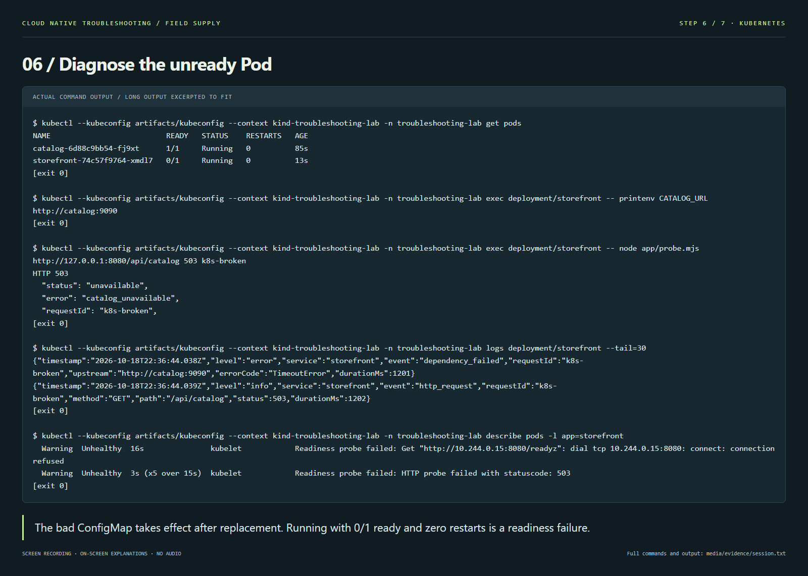
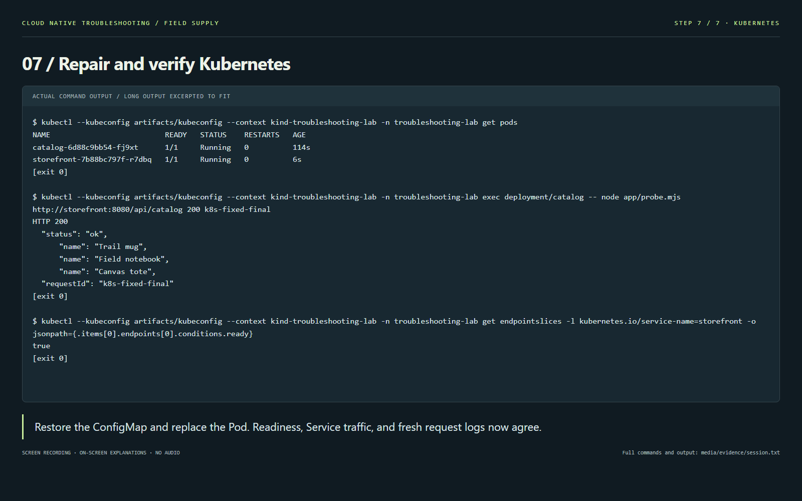

# 3. Kubernetes: diagnose a running but unready Pod

**Time:** 20–30 minutes, including image download. **Goal:** reproduce the same fault using a ConfigMap; use Pod status, logs, probes, and Service routing to prove recovery.

Use the dedicated kind cluster below. Every kubectl command explicitly names its context and namespace. The storefront has one replica with `Recreate`, so each configuration change intentionally interrupts service.

## Step 1 — Create a cluster and load the image

```sh
kind create cluster --name troubleshooting-lab --image kindest/node:v1.32.2@sha256:f226345927d7e348497136874b6d207e0b32cc52154ad8323129352923a3142f --wait 120s
docker build -t troubleshooting-storefront:1.0 .
kind load docker-image troubleshooting-storefront:1.0 --name troubleshooting-lab
kubectl --context kind-troubleshooting-lab get nodes
```

Expected: one node named `troubleshooting-lab-control-plane`, status `Ready`. If the named lab cluster already exists, skip creation and run `kind export kubeconfig --name troubleshooting-lab` before the kubectl commands to make its context available in your current kubeconfig. Loading the image matters: the manifests deliberately use `imagePullPolicy: Never` and do not pull from a registry.

## Step 2 — Deploy and establish a baseline

```sh
kubectl --context kind-troubleshooting-lab apply -f k8s/00-namespace.yaml
kubectl --context kind-troubleshooting-lab apply -f k8s/
kubectl --context kind-troubleshooting-lab -n troubleshooting-lab rollout status deployment/catalog --timeout=90s
kubectl --context kind-troubleshooting-lab -n troubleshooting-lab rollout status deployment/storefront --timeout=90s
kubectl --context kind-troubleshooting-lab -n troubleshooting-lab get pods,svc
kubectl --context kind-troubleshooting-lab -n troubleshooting-lab exec deployment/catalog -- node app/probe.mjs http://storefront:8080/api/catalog 200 k8s-baseline
```

Expected: both Pods `1/1 Running`, both Services have ClusterIPs, and a real request through the **storefront Service** returns HTTP 200 and three products. Pod names and IPs vary.

```text
NAME                            READY   STATUS    RESTARTS
pod/catalog-<hash>-<suffix>      1/1     Running   0
pod/storefront-<hash>-<suffix>   1/1     Running   0
HTTP 200
```

## Step 3 — Apply the bad configuration

```sh
kubectl --context kind-troubleshooting-lab apply -f scenarios/k8s.bad-port.yaml
kubectl --context kind-troubleshooting-lab -n troubleshooting-lab rollout restart deployment/storefront
kubectl --context kind-troubleshooting-lab -n troubleshooting-lab rollout status deployment/storefront --timeout=30s
```

The last command is **expected to time out with a nonzero exit code**. Do not skip the next step. Changing a ConfigMap used as an environment variable does not update a running process; the restart replaces the Pod so it reads the new value.

## Step 4 — Inspect status, events, and logs

```sh
kubectl --context kind-troubleshooting-lab -n troubleshooting-lab get pods
kubectl --context kind-troubleshooting-lab -n troubleshooting-lab describe pods -l app=storefront
kubectl --context kind-troubleshooting-lab -n troubleshooting-lab logs deployment/storefront --tail=20
kubectl --context kind-troubleshooting-lab -n troubleshooting-lab get configmap storefront-config -o yaml
kubectl --context kind-troubleshooting-lab -n troubleshooting-lab exec deployment/storefront -- printenv CATALOG_URL
```

Expected, abbreviated:

```text
catalog-<hash>-<suffix>      1/1   Running   0
storefront-<hash>-<suffix>   0/1   Running   0
Warning  Unhealthy  ...  Readiness probe failed: HTTP probe failed with statuscode: 503
http://catalog:9090
```



The Pod is **Running** but **0/1 ready**. Liveness succeeds, so restart count should stay stable. Logs show `dependency_failed` and `upstream: http://catalog:9090`. In the recorded kind run, `errorCode` is **`TimeoutError`**: port 9090 is not exposed by the catalog Service, and the connection exceeds the 1.2 s request budget. Depending on Service/network implementation, you may instead see `ECONNREFUSED`. Docker's direct container connection in the first track returned `ECONNREFUSED`; the root configuration error is the same.

If the container has actually restarted, `kubectl ... logs <pod-name> --previous` shows logs from its previous instance. In this incident no restart is expected, so `--previous` would report that no previous terminated container exists.

## Step 5 — Separate the process, dependency, and Service

```sh
kubectl --context kind-troubleshooting-lab -n troubleshooting-lab exec deployment/storefront -- node app/probe.mjs http://127.0.0.1:8080/livez 200
kubectl --context kind-troubleshooting-lab -n troubleshooting-lab exec deployment/storefront -- node app/probe.mjs http://127.0.0.1:8080/readyz 503
kubectl --context kind-troubleshooting-lab -n troubleshooting-lab exec deployment/storefront -- node app/probe.mjs http://127.0.0.1:8080/api/catalog 503 k8s-broken
kubectl --context kind-troubleshooting-lab -n troubleshooting-lab exec deployment/storefront -- node app/probe.mjs http://catalog:8081/items 200
kubectl --context kind-troubleshooting-lab -n troubleshooting-lab get svc catalog -o yaml
kubectl --context kind-troubleshooting-lab -n troubleshooting-lab get endpointslices -l kubernetes.io/service-name=storefront -o yaml
```

Expected: `/livez` is 200, `/readyz` and `/api/catalog` are 503, and catalog at port 8081 is 200. The catalog Service port is **8081**, while the process environment says **9090**. Find `requestId: k8s-broken` in the storefront logs.

In the storefront EndpointSlice, the Pod's endpoint has `conditions.ready: false`. Kubernetes stops routing ordinary Service traffic to that unready endpoint. Calling `localhost` from inside the Pod bypasses Service routing, which is why it can reveal the application's 503 directly.

**Checkpoint:** why does this state differ from `CrashLoopBackOff`? Why should a catalog outage fail readiness rather than liveness?

## Step 6 — Fix the ConfigMap and replace the Pod

```sh
kubectl --context kind-troubleshooting-lab apply -f k8s/01-configmap.yaml
kubectl --context kind-troubleshooting-lab -n troubleshooting-lab rollout restart deployment/storefront
kubectl --context kind-troubleshooting-lab -n troubleshooting-lab rollout status deployment/storefront --timeout=90s
kubectl --context kind-troubleshooting-lab -n troubleshooting-lab exec deployment/storefront -- printenv CATALOG_URL
```

Expected: `deployment "storefront" successfully rolled out` and `http://catalog:8081`. Updating the ConfigMap alone leaves the old environment in the old Pod; replacing it is part of the repair.

## Step 7 — Verify the fix through the Service

```sh
kubectl --context kind-troubleshooting-lab -n troubleshooting-lab get pods
kubectl --context kind-troubleshooting-lab -n troubleshooting-lab get endpointslices -l kubernetes.io/service-name=storefront -o yaml
kubectl --context kind-troubleshooting-lab -n troubleshooting-lab exec deployment/storefront -- node app/probe.mjs http://127.0.0.1:8080/readyz 200
kubectl --context kind-troubleshooting-lab -n troubleshooting-lab exec deployment/catalog -- node app/probe.mjs http://storefront:8080/api/catalog 200 k8s-fixed-1
kubectl --context kind-troubleshooting-lab -n troubleshooting-lab exec deployment/catalog -- node app/probe.mjs http://storefront:8080/api/catalog 200 k8s-fixed-2
kubectl --context kind-troubleshooting-lab -n troubleshooting-lab exec deployment/catalog -- node app/probe.mjs http://storefront:8080/api/catalog 200 k8s-fixed-3
kubectl --context kind-troubleshooting-lab -n troubleshooting-lab logs deployment/storefront --since=2m --tail=20
```

All success criteria must hold:

- Both Pods are `1/1 Running`; storefront's restart count stays stable.
- The storefront endpoint has `conditions.ready: true`.
- Readiness and all three requests return HTTP 200; each catalog response contains three products.
- Fresh logs for `k8s-fixed-1` through `k8s-fixed-3` contain status 200 and no matching dependency failures.



To open the Kubernetes application in a browser, stop the Docker track first if it still owns port 8080. Then, in a separate terminal:

```sh
kubectl --context kind-troubleshooting-lab -n troubleshooting-lab port-forward service/storefront 8080:8080
```

Open http://localhost:8080. Ctrl+C stops forwarding. Port forwarding is a convenient access path; the in-cluster requests above verify actual Service routing.

## Step 8 — Clean up

Stop port forwarding before cleanup. Delete only the resources used by this lab:

```sh
kubectl --context kind-troubleshooting-lab delete namespace troubleshooting-lab
kind delete cluster --name troubleshooting-lab
```

If reusing the cluster for another exercise, keep the cluster and delete only the namespace. Do not delete unrelated clusters or namespaces.

References: [kind image loading](https://kind.sigs.k8s.io/docs/user/quick-start/#loading-an-image-into-your-cluster), [ConfigMap updates and environment variables](https://kubernetes.io/docs/tutorials/configuration/updating-configuration-via-a-configmap/), [readiness and Service traffic](https://kubernetes.io/docs/tasks/configure-pod-container/configure-liveness-readiness-startup-probes/).
